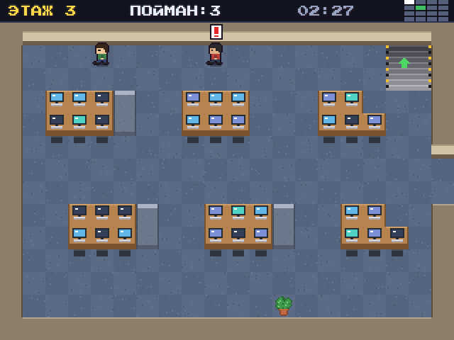

# Office Escape

A 16-bit style browser game (*Побег из опенспейса* in Russian). You are a programmer who has had enough of work. Five floors of offices stand between your desk and the lobby exit, and every PM and boss who spots you gives chase.



## Play

Play at <https://pravbeseda.github.io/office-escape/>, on a computer or a phone. On a phone, add the page to the home screen to play full screen without the browser bars. To play locally, clone the repository and open `index.html` in a browser; there is nothing to build or install. The game speaks English, or Russian when Russian comes before English in the browser's language settings.

| Action | Keyboard | Touch screen |
| --- | --- | --- |
| Move | Arrows / WASD | Drag a finger anywhere on the screen |
| Start, continue a dialogue | Enter / Space | Tap |
| Pause | Esc / P | The II button |

## Rules

- You start at your desk on the 5th floor. Find the stairs down on each floor; the exit is in the lobby on the 1st floor.
- Each floor is a 4×4 grid of screens. A screen is generated the first time you walk into it: open-plan offices, glass meeting rooms, kitchens, server rooms, corridors, a boss's office.
- Bosses spot you inside their view cone when nothing blocks the line of sight, and up close they notice you even from behind. Walls, cubicle partitions, plants and server racks hide you; glass and desks do not.
- PMs roam the top floors; team leads, directors and the CEO wait further down. Once they spot you, they chase you, through doors too.
- A catch sends you back to your desk in the same building, so every attempt teaches you the way. A new game builds a new building.
- A guard watches the turnstiles at the exit. Slip past while he reads his newspaper.

## Development

The game is plain JavaScript on a canvas with no dependencies. Run the logic tests with Node's built-in test runner:

```sh
npm test
```

[AGENTS.md](AGENTS.md) describes the module layout and the invariants the code keeps.

## License

[MIT](LICENSE)
